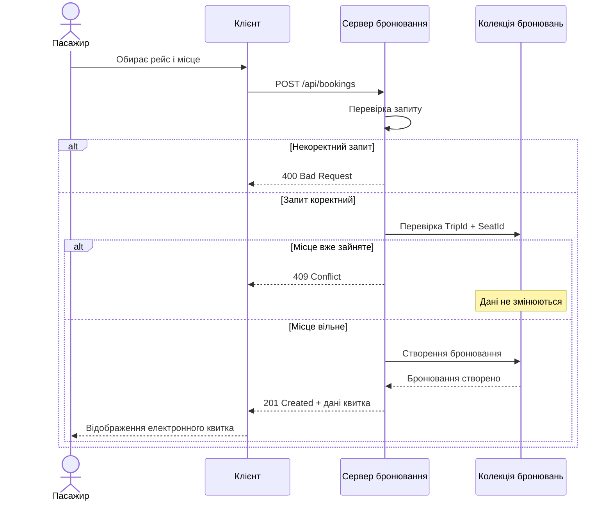

# UC-01 — Бронювання автобусного квитка

## 1. Мета

Мета сценарію — надати пасажиру можливість забронювати місце на обраному активному автобусному рейсі та отримати електронний квиток.

## 2. Контракт API

**Метод:** `POST`

**Endpoint:** `/api/bookings`

**Тіло запиту:**

```json
{
  "tripId": 1,
  "seatId": "12"
}
```

**Успішна відповідь:** `201 Created`

Сервер створює запис бронювання та повертає його ідентифікатор, номер рейсу, номер місця та дату створення.

**Відповідь при зайнятому місці:** `409 Conflict`

Сервер відхиляє бронювання, якщо обране місце вже заброньоване на цьому рейсі. Дані в колекції не змінюються.

**Некоректний запит:** `400 Bad Request`

Сервер відхиляє запит, якщо передані некоректні або відсутні дані.

## 3. Діаграма послідовності



## 4. Бізнес-правила

- Одне місце можна забронювати лише один раз на конкретному рейсі.
- Перевірка доступності місця та створення бронювання повинні виконуватися безпечно при одночасних запитах.
- Якщо бронювання відхилено, дані не повинні змінюватися.
- У версії 1 дані бронювань зберігаються в оперативній пам'яті.
- Після перезапуску застосунку дані в оперативній пам'яті втрачаються.
- API повинен повертати зрозумілий результат успішного бронювання або відмови.

## 5. Тестові сценарії

| Тест | Очікуваний результат |
|---|---|
| Бронювання вільного місця | `201 Created` |
| Повторне бронювання того самого місця на тому самому рейсі | `409 Conflict` |
| Бронювання того самого місця на іншому рейсі | Успішне, якщо воно вільне |
| Надсилання некоректних даних | `400 Bad Request` |
| Відхилене бронювання | Раніше збережені дані не змінюються |
