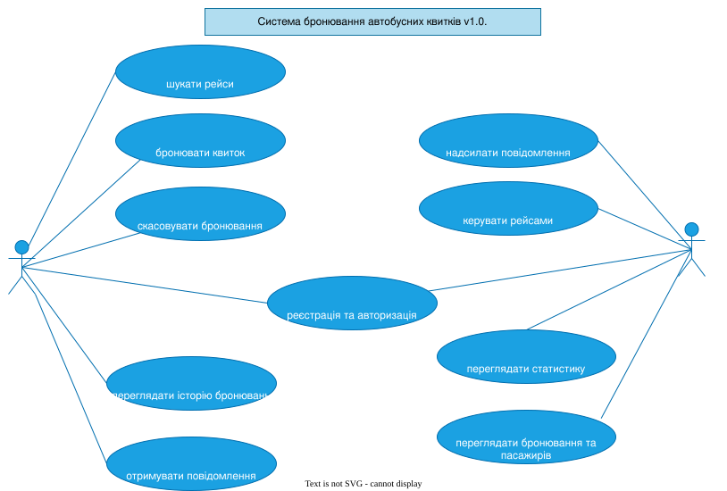
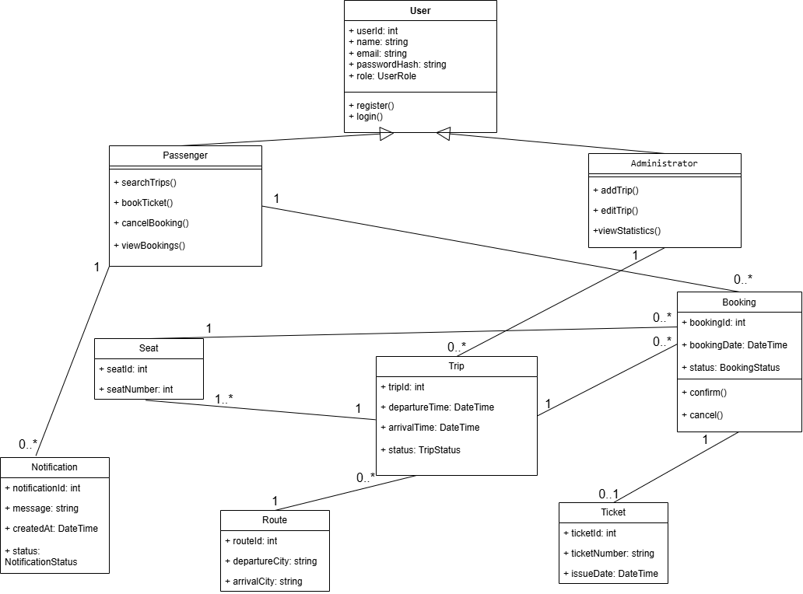
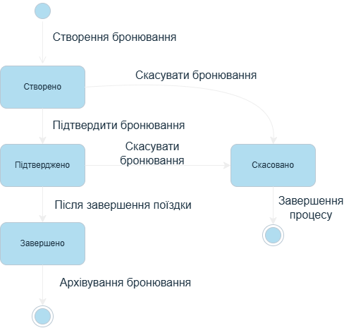

# Проєктування v1.0

## Діаграма варіантів використання (Use Case Diagram)

Ця діаграма відповідає на інженерне питання: хто взаємодіє із системою у межах v1.0 і яких цілей досягає? Вона показує межі системи, основних акторів (Пасажир, Адміністратор) та ключові прецеденти (сценарії), які вони виконують.

## Діаграма класів (Class Diagram)

Діаграма класів відображає структуру системи бронювання автобусних квитків, основні сутності, їхні атрибути, операції та зв'язки.

## Діаграма станів бронювання (State Machine Diagram)

Діаграма показує основні стани бронювання квитка та переходи між ними протягом його життєвого циклу.

