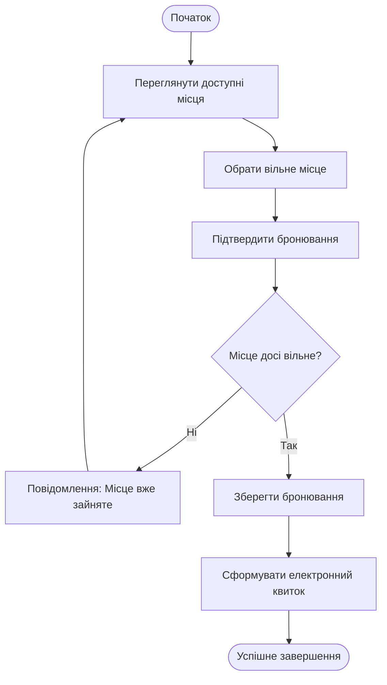
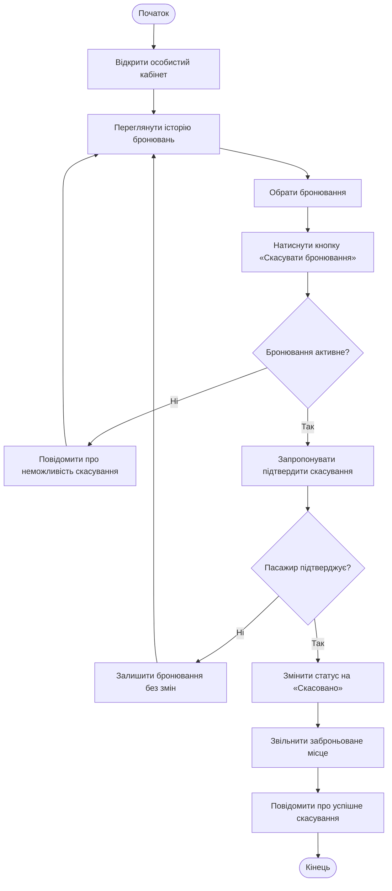

UC-01 — Бронювання квитка

Індивідуальна частина: Чорноус А.

Мета: Забронювати місце на обраний автобусний рейс та отримати електронний квиток.

Основний актор: Пасажир.

Тригер: Пасажир обирає потрібний рейс із результатів пошуку та переходить до вибору місць.

Передумови:

Пасажир авторизований у системі.
Обраний рейс має статус «Активний».
Основний успішний сценарій
Пасажир переглядає доступні місця на схемі автобуса.
Пасажир обирає вільне місце.
Система пропонує підтвердити дані бронювання.
Пасажир підтверджує бронювання.
Система перевіряє, чи місце все ще вільне, щоб запобігти одночасному бронюванню одного місця кількома пасажирами.
Система зберігає бронювання та формує електронний квиток.
Пасажир бачить електронний квиток в особистому кабінеті.
Альтернативні потоки
A1 — Місце вже зайняте (на кроці 5):

Система виявляє, що місце вже заброньоване іншим користувачем.
Система відхиляє запит на бронювання.
Система виводить повідомлення про помилку.
Система повертає пасажира до перегляду доступних місць (крок 1 основного сценарію).
Постумови
Електронний квиток збережено в системі.
Обране місце закріплено за пасажиром і стає недоступним для інших користувачів.
Пов'язані вимоги: FR-03, NFR-02.

### Activity Diagram для UC-01

UC-02 — Скасування бронювання квитка

Індивідуальна частина: Макаренко Д.

Мета: Скасувати активне бронювання автобусного квитка та звільнити заброньоване місце для інших пасажирів.

Основний актор: Пасажир.

Тригер: Пасажир вирішує скасувати раніше створене бронювання.

Передумови:

Пасажир авторизований у системі.
У пасажира є бронювання, яке можна скасувати.
Бронювання має статус «Підтверджено».

Основний успішний сценарій

Пасажир відкриває особистий кабінет.
Пасажир переходить до історії бронювань.
Система відображає список бронювань пасажира.
Пасажир обирає бронювання, яке потрібно скасувати.
Пасажир натискає кнопку «Скасувати бронювання».
Система перевіряє статус бронювання.
Система пропонує підтвердити скасування.
Пасажир підтверджує скасування.
Система змінює статус бронювання на «Скасовано».
Система звільняє раніше заброньоване місце.
Система повідомляє пасажира про успішне скасування.

Альтернативні потоки

A1 — Бронювання не можна скасувати.

На кроці 6 система визначає, що бронювання вже скасоване або має статус, за якого скасування недоступне.
Система повідомляє пасажира про неможливість скасування.
Пасажир повертається до списку бронювань.
Статус бронювання та стан місця не змінюються.

A2 — Пасажир відмовляється від скасування.

На кроці 7 система пропонує підтвердити скасування.
Пасажир відмовляється від скасування.
Система не змінює статус бронювання та не звільняє місце.
Пасажир повертається до перегляду бронювання.

Постумови

У разі успішного скасування:
Бронювання отримує статус «Скасовано».
Раніше заброньоване місце стає доступним для інших пасажирів.
Пасажир отримує повідомлення про успішне скасування.

Якщо скасування не відбулося:
Статус бронювання залишається без змін.
Місце залишається у попередньому стані.

Зв’язок із вимогами

FR-04: система надає пасажиру можливість переглядати історію бронювань і скасовувати активні бронювання. Після скасування статус бронювання змінюється, а місце стає вільним.
NFR-02: система повинна запобігати одночасному бронюванню одного місця кількома пасажирами.

### Activity Diagram для UC-02

